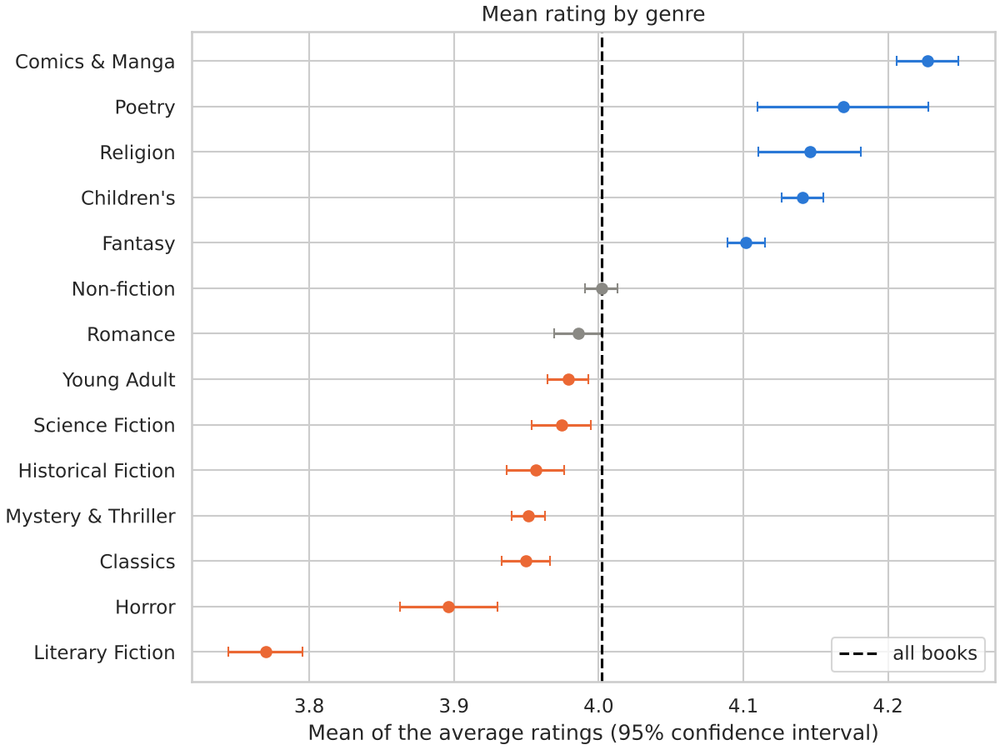
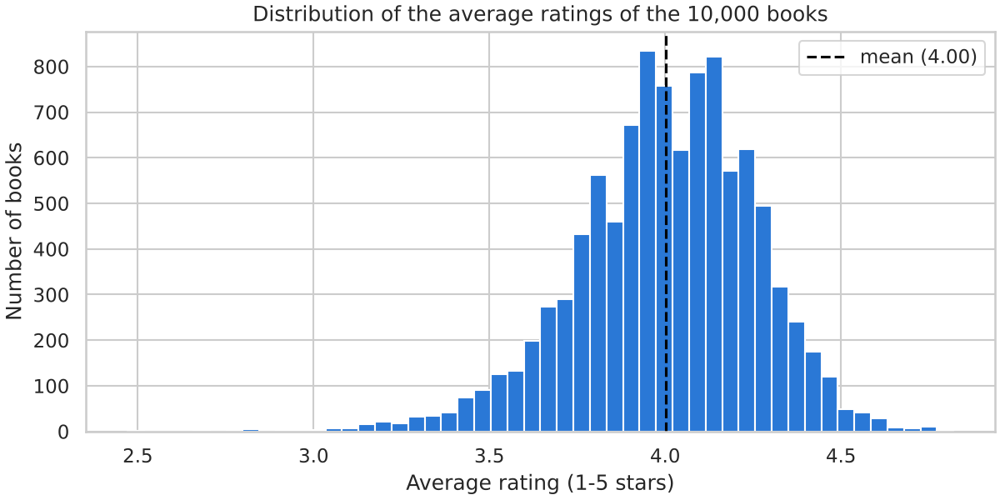
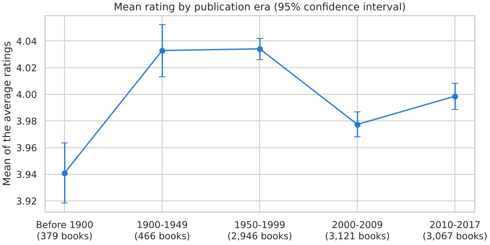
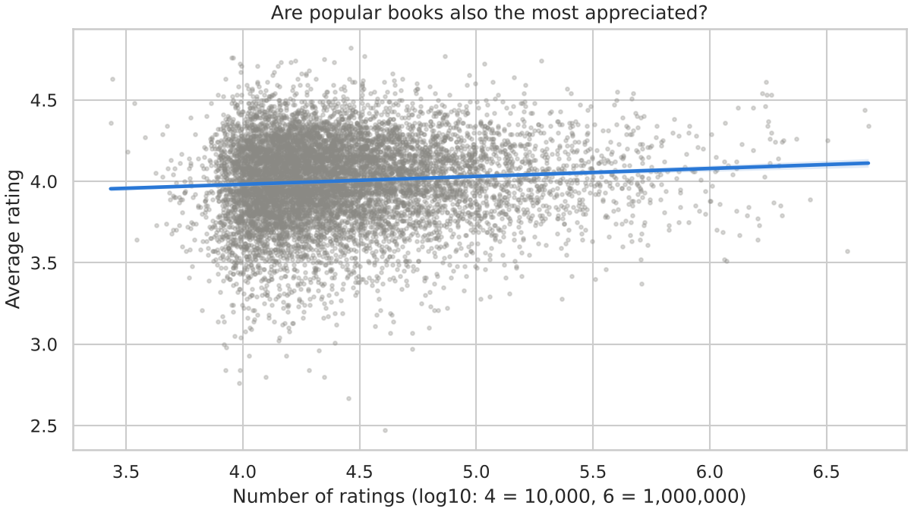
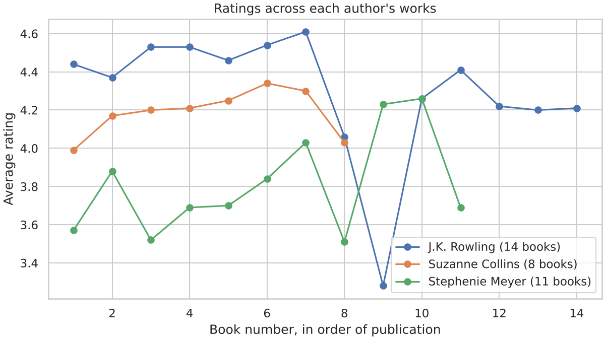

# Book-Analysis-Project-Yang

# 📚 What makes a book loved by readers?

An analysis of the [goodbooks-10k](https://github.com/zygmuntz/goodbooks-10k) dataset
(the *Page Turners* project proposal): the 10,000 most popular books on Goodreads,
about 6 million ratings by 53,424 readers, and the tags that readers used to shelve
the books.

The project looks at the factors that go together with how much a book is
appreciated (its average rating, from 1 to 5 stars):

1. How are the ratings distributed, and how **divisive** are the books?
2. Are some **genres** consistently rated higher?
3. Are **older books** rated differently from recent ones?
4. Are **popular** books also the most appreciated?
5. How do the ratings of an **author** evolve across their works?
6. How do the individual **readers** rate?

The analysis is told step by step in a **Jupyter notebook**, and can be explored in an
interactive **Streamlit web app**. Both use the functions of the `goodbooks` package:
no analysis code is duplicated.



## Data

| | |
|---|---|
| **Source** | [goodbooks-10k](https://github.com/zygmuntz/goodbooks-10k), by Zygmunt Zając (2017), from Goodreads |
| **Files used** | `books.csv` (10,000 books), `ratings.csv` (6 M ratings, 72 MB), `tags.csv` (34,252 tags), `book_tags.csv` (1 M book-tag pairs) |
| **License** | CC BY-SA 4.0 |

**You don't need to download anything by hand.** The first time the notebook or the
app runs, `data.download_dataset()` downloads the four CSV files from GitHub into the
`data/` folder (only the missing ones, so it happens once). The `data/` folder is in
`.gitignore`, so the files are never committed.

If the download fails (e.g. no connection), the code stops with a clear message:
download the four CSV files by hand from the GitHub repository and put them in `data/`.

## Libraries

| Library | Used for |
|---|---|
| **pandas** | loading, cleaning, merging, grouping and reshaping the tables |
| **NumPy** | vectorised statistics (standard deviation of the stars, trend lines) |
| **SciPy** (`scipy.stats`) | Mann-Whitney U tests, Spearman correlations, linear regression |
| **matplotlib**, **seaborn** | the charts of the notebook (saved in `results/`) |
| **Plotly** | the interactive charts of the web app |
| **Streamlit** | the web app |
| **requests** | downloading the dataset |
| **ipykernel** | running the notebook in VS Code or Jupyter |

The exact versions are in `requirements.txt`.

## Project Structure

```
python project/
├── README.md
├── requirements.txt            # the libraries, with their versions
├── .gitignore
├── data/                       # the CSV files (downloaded, not in Git)
├── goodbooks/                  # the package: all the logic of the project
│   ├── __init__.py
│   ├── data.py                 # download, load, clean, search and save the data
│   ├── genres.py               # from user tags to genres
│   ├── analysis.py             # statistics (pandas, NumPy, SciPy)
│   ├── plots.py                # static charts (matplotlib, seaborn)
│   └── interactive.py          # interactive charts (Plotly)
├── notebooks/
│   └── goodbooks_walkthrough.ipynb   # the presentation of the analysis
├── results/                    # tables (CSV) and charts (PNG) saved by the notebook
├── app.py                      # the web app: home page...
├── app_utils.py                # ...helpers shared by its pages (loading, reading list)...
└── pages/                      # ...and its other pages
    ├── 1_🏷️_Genres.py
    ├── 2_🕰️_Old_vs_recent.py
    ├── 3_📈_Popularity.py
    ├── 4_✍️_Authors.py
    └── 5_🔎_Book_explorer.py
```

The package only *defines* things: its functions return tables and figures, and the
notebook and the app decide what to display.

## Setup

The project needs **Python 3.12** or later. From the root of the project:

```bash
python -m venv .venv
source .venv/bin/activate        # on Windows: .venv\Scripts\activate
pip install -r requirements.txt
```

## Run

**Notebook.** Open `notebooks/goodbooks_walkthrough.ipynb` in VS Code (choose the
`.venv` kernel) or in Jupyter, then *Restart* and *Run All*. The first run downloads
the data (a minute or so); the tables and the charts are saved in `results/`.

**Web app.** From the root of the project, with the environment active:

```bash
streamlit run app.py
```

The app opens in the browser. Its pages:

| Page | What you can do |
|---|---|
| **Home** | key numbers, the best-loved books with their covers, the distribution of the ratings |
| **🏷️ Genres** | compare the genres, with confidence intervals and tests; hover over the box plots to see the books |
| **🕰️ Old vs recent** | filter by genre and starting year; a heatmap of genre × publication era |
| **📈 Popularity** | an interactive scatter of all the books (filter genres, zoom, hover); the best-loved books |
| **✍️ Authors** | pick authors and follow their ratings book after book |
| **🔎 Book explorer** | search a book, see its cover and how readers rated it, and add it to your **reading list**, which stays in the sidebar on every page (`st.session_state`) and lets you compare books |

## Methods

- **Cleaning.** Duplicate books are removed, the publication year becomes an integer
  (with missing values) and is grouped into eras with `pd.cut`; the first author is the
  main author; series names are removed from the titles with a regular expression; box
  sets and collections are marked, since they are not new works; negative tag counts
  are dropped; individual ratings outside 1-5 and duplicate (user, book) pairs are
  removed. `ratings.csv` is loaded with small integer types (140 MB → 40 MB in memory).
- **Genres** come from the user tags: each genre has a few tags (e.g. `sci-fi`,
  `scifi`, `science-fiction`), and each book gets the genre whose tags were used most.
- **Divisiveness** of a book is the standard deviation of its 1-5 stars, computed for
  all the books at once with NumPy (matrix product of the star counts).
- **Means** are shown with a 95% confidence interval (mean ± 1.96 standard errors).
- **Comparisons** between a genre and the other books use the Mann-Whitney U test,
  which doesn't assume normal data; **correlations** use Spearman's coefficient.
- **Trends** are straight lines fitted with `scipy.stats.linregress` (years) and
  `np.polyfit` (the books of each author).
- **Genre × era** is a pivot table (`pivot_table`); cells with fewer than 10 books are
  left empty.
- The **weighted rating** `WR = v/(v+m)·R + m/(v+m)·C` pulls the average rating `R` of
  the books with few ratings `v` toward the mean of all the books `C`
  (`m` = median number of ratings), so a book can't top the ranking by chance.

## Main Findings

- **Ratings are high and concentrated** (mean 4.0, half of the books between 3.85 and
  4.18). The best-loved books are also the least divisive (Spearman ρ ≈ −0.64).
- **Genre matters most**: comics & manga, poetry, religion, children's books and
  fantasy are consistently rated higher; literary fiction and horror lower.
- The **publication year** explains almost nothing (R² < 0.01 since 1900), and old
  books suffer from survivorship bias: the ones still read today are the classics.
- **Popularity** and appreciation are almost unrelated: many ratings don't mean high
  ratings.
- **Authors** don't get generally better or worse: about half improve, half decline.
- **Readers are generous**: about 69% of the ratings are 4 or 5 stars; the most active
  readers are slightly harsher.

| | |
|---|---|
|  |  |
|  |  |

## Code Style

The code follows PEP 8 and uses NumPy-style docstrings. It is checked and formatted
with [Ruff](https://docs.astral.sh/ruff/):

```bash
pip install ruff
ruff check .
ruff format .
```